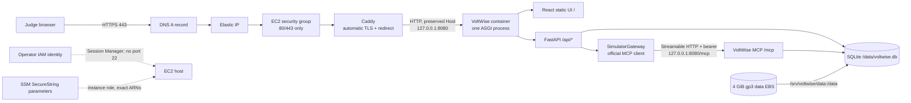

# AWS deployment preflight and execution plan

Status: planning only. This document does not create resources, authenticate to
AWS, deploy VoltWise, or spend promotional credit. Prices and service facts were
checked against official AWS sources on **2026-10-08** and must be rechecked in
the AWS Pricing Calculator immediately before deployment.

## Decision

Deploy one `linux/amd64` VoltWise container on one On-Demand
`t3a.small` EC2 instance in `us-east-1`, with:

- Caddy on the host terminating public HTTPS on ports 80/443;
- the container using Linux host networking and listening only on
  `127.0.0.1:8080`;
- a 20 GiB gp3 root volume and a separate 4 GiB gp3 data volume mounted at
  `/srv/voltwise/data` and bind-mounted into the container as `/data`;
- one Uvicorn worker, one application instance, and no autoscaling;
- an Elastic IP and an existing DNS name;
- Systems Manager Session Manager for administration, with no inbound SSH;
- three SSM Parameter Store `SecureString` parameters injected into a root-only
  file under `/run` at startup; and
- public-demo mode, shared HTTP Basic judge access, and the separate private MCP
  bearer token already required by the application.

This is the smallest architecture that matches VoltWise's tested constraints:
one public origin, real loopback Streamable HTTP MCP, process-local MCP sessions,
global simulator state, and SQLite on local block storage. It avoids the fixed
cost and additional failure surface of an Application Load Balancer (ALB), NAT
Gateway, ECS control plane configuration, EFS, and a container registry.

It is not highly available. Recovery is replacement of the instance plus
reattachment/restoration of the data volume. That is an explicit hackathon
tradeoff, not a production guarantee.

## Architecture



Only Caddy is internet-reachable. Port 8080 is not in the security group and,
because the application binds to loopback in the host network namespace, is not
reachable on the instance's public or private interface.

## Validated application assumptions

The repository already contains the production shape this plan uses:

- `Dockerfile` builds the pinned React frontend and serves it from the Python
  runtime image as non-root user `voltwise`.
- `python -m app.deployment` starts one Uvicorn worker and one combined ASGI
  application.
- `/` serves the React build, `/api/...` serves FastAPI, `/mcp` is the genuine
  MCP SDK Streamable HTTP application, and `/health` is side-effect-free
  liveness.
- `POST /api/sim/chat` uses the official MCP client over loopback HTTP. There is
  no direct application fallback when MCP fails.
- `VOLTWISE_DB_PATH=/data/voltwise.db` contains the selected demo state, events,
  and MCP trace history. A reset restores active demo state while preserving
  historical audit evidence.
- the public security mode fails startup without Basic credentials and a
  distinct MCP bearer token. It disables API documentation, protects UI/API/
  history with Basic authentication, and protects `/mcp` with bearer auth.
- rate limits are in-memory and per process; simulator/device state is global.

No domain, tariff, safety, MCP-tool, or frontend change is required for this
deployment plan. The repository's Docker image still requires execution on a
real Linux Docker engine before deployment can be declared ready.

## Option comparison

| Option | Advantages | Cost and operational issues | Fit |
| --- | --- | --- | --- |
| One EC2 + EBS + Caddy | Direct Docker build from source; local gp3 semantics suit SQLite; stable single-instance state; no ALB; easiest recovery model | Operator owns patching, Caddy, backups, and instance recovery; one host is a single point of failure | **Recommended** |
| One EC2 + EBS + ALB/ACM | AWS-managed certificate and health-checked ingress | ALB adds a fixed hourly charge, LCUs, public IPv4 charges, security groups, and another hop while the instance is still a single point of failure | Not justified for this demo |
| ECS Express Mode | Automatically provisions ECS/Fargate, ALB TLS, networking, observability, and autoscaling; no Express surcharge | Underlying Fargate/ALB/log/network charges remain; defaults can scale beyond one task; more generated resources; persistent SQLite does not fit | Reject |
| Hand-built ECS/Fargate service | Managed task replacement and no host patching | Needs image registry and ingress; durable storage is the hard part; EBS volumes attached to ECS services are deleted on task termination; EFS adds cost and SQLite-on-EFS is unverified | Reject |

ECS Express Mode creates a Fargate service and ALB and defaults to a minimum of
one and maximum of 20 tasks. VoltWise must not horizontally scale because MCP
sessions, simulator state, rate limits, and SQLite are not replica-safe. AWS
also documents that service-managed EBS volumes are always deleted when the ECS
task terminates. An EFS redesign/load test is outside this phase.

A Linux EC2 instance can build this multi-stage Dockerfile directly with Docker
Engine. Its pinned Node and Python base images publish `linux/amd64` variants,
so the build does not depend on local Windows Docker Desktop. Choosing x86
`t3a.small` also avoids introducing an ARM compatibility variable.

## Region and instance

Use **US East (N. Virginia), `us-east-1`**, subject to a final account quota and
service-availability check. The reasons are the officially published low
On-Demand rate used in this estimate, broad EC2/EBS/SSM/Fargate/ALB availability,
and a reasonable neutral location for an international web demo. This is not a
claim that it is the lowest-latency region for every judge. If the judging
audience is known to be concentrated elsewhere, compare that region's current
price and measured latency before creating anything.

Use `t3a.small` (2 vCPU, 2 GiB RAM), not `t3a.micro`. Two GiB is a modest floor
for the Docker build plus the Python service and Caddy. Configure **T3 Standard
mode**, not the default Unlimited mode, to prevent surplus CPU-credit charges.
Builds may slow after credits are exhausted; temporarily moving to
`t3a.medium`, then stopping and resizing back, is the controlled fallback.

Use Ubuntu Server 24.04 LTS x86_64 or Amazon Linux 2023 x86_64, whichever the
operator can patch confidently. Pin the selected AMI ID in the execution record;
do not copy an old AMI ID from this document.

## Cost estimate

All figures are USD, On-Demand, `us-east-1`, and exclude tax. A month is 730
hours. The judging-window estimate assumes continuous operation, prorates EBS,
and includes one full 4 GiB snapshot even though EBS snapshots are incremental.
The DNS example assumes 100,000 standard queries. It excludes a new domain,
data transfer above the free allowance, optional scanners, CloudWatch log
ingestion, and unexpected CPU surplus charges.

| Item | Published rate/assumption | 7 days | 14 days | 730-hour month |
| --- | ---: | ---: | ---: | ---: |
| `t3a.small` Linux | $0.0188/hour | $3.16 | $6.32 | $13.72 |
| One public IPv4 | $0.005/hour | $0.84 | $1.68 | $3.65 |
| 24 GiB total gp3 | $0.08/GB-month, prorated | $0.44 | $0.88 | $1.92 |
| Route 53 hosted zone, optional | $0.50/month, not prorated | $0.50 | $0.50 | $0.50 |
| 100k standard DNS queries, optional | $0.40/million | $0.04 | $0.04 | $0.04 |
| One full 4 GiB snapshot allowance | $0.05/GB-month | $0.20 | $0.20 | $0.20 |
| **Total with optional DNS/snapshot assumptions** |  | **$5.18** | **$9.62** | **$20.03** |
| **Total using existing external DNS, no snapshot** |  | **$4.44** | **$8.88** | **$19.29** |

The selected capacity is approximately **$19.30-$20.03/month** under these
assumptions, leaving substantial margin inside $150 of promotional credit. That
margin is not permission to leave resources running.

For comparison:

- one continuously running Fargate Linux/x86 task at 0.25 vCPU/0.5 GiB is about
  $0.0123426/hour or $9.01/730 hours from the published CPU/memory rates;
- an ALB adds at least $0.0225/hour, or $16.43/730 hours, before LCU and public
  IPv4 charges; and
- Fargate/Express still needs ALB, image storage, logs, networking, and a
  persistence answer. Its complete cost is therefore **not verified** here
  because EFS and the precise generated Express resources have not been sized.

Do not interpret AWS Budgets as a hard cap. Billing data and alerts can lag.
Create:

1. a $25 monthly cost budget with actual alerts at 50%, 75%, 90%, and 100%, and
   forecast alerts at 80% and 100%; and
2. a $100 project/credit-protection budget with actual alerts at 50%, 75%, and
   90%, and a forecast alert at 75%.

Send both to at least two monitored email addresses. Do not attach an automatic
stop action during judging; delayed automation can interrupt the demo and still
does not guarantee a cap. The standard alert-only budgets are free according to
AWS's pricing page; action-enabled budget pricing is separate.

### Promotional-credit caveats

Before provisioning, open Billing and Cost Management and verify the actual
credit balance, expiry date, and eligible-service list. AWS says credits apply
only to eligible services and automatically offset eligible charges. The public
terms exclude, among other categories, Route 53 **domain registration or
transfer**, Marketplace, certain support/professional services, training,
certification, and upfront Reserved Instance/Savings Plan fees. Transaction
taxes are not covered. The exact hackathon credit instrument can be narrower,
so EC2, EBS, public IPv4, Route 53 hosted-zone, SSM, and snapshot eligibility
must be confirmed in the account rather than assumed.

## Deployment prerequisites

The operator must have all of the following before go-live:

- an AWS account with the promotional credit already visible, MFA on the root
  user, and no use of root for deployment;
- one operator IAM identity/role with least-privilege provisioning permissions;
- an existing controllable DNS hostname such as `demo.example.com`;
- AWS CLI v2 and the Session Manager plugin on the operator machine **for the
  execution phase only**; no login is needed during this planning phase;
- the source tree copied without `.env`, databases, browser profiles, test
  artifacts, screenshots, `node_modules`, `.venv`, or secrets;
- a SHA-256 checksum of that source archive;
- two generated high-entropy, distinct secrets: the judge password and MCP
  bearer token, plus a non-sensitive judge username;
- a documented owner, judging start/end time, cleanup time, and backup decision;
- account quotas for one On-Demand `t3a.small`, two EBS volumes plus the
  eventual snapshot, one Elastic IP, and the required security groups; and
- successful local repository tests and production build from the commit/source
  archive that will be uploaded.

If no DNS name is available, stop. Caddy's public ACME flow requires a hostname
resolving to the instance and inbound 80/443. Do not substitute plaintext HTTP,
a self-signed certificate, or secrets in URL query parameters.

## Network, TLS, and host configuration

### DNS and firewall

Allocate one Elastic IP and point the hostname's A record to it. An existing DNS
provider is sufficient; Route 53 is optional. Use a short TTL such as 300 seconds
during rollout, then raise it after the address is stable.

The EC2 security group must permit:

- inbound TCP 80 from `0.0.0.0/0` for ACME and HTTPS redirect;
- inbound TCP 443 from `0.0.0.0/0` for judges;
- no inbound 22 and no inbound 8080; and
- outbound HTTPS/DNS needed for package installation, base-image pulls, SSM,
  Parameter Store, certificate issuance, and updates.

Use Session Manager through an instance role with
`AmazonSSMManagedInstanceCore`; do not create or copy a long-lived AWS access key
to the instance. If the selected public-subnet design has no VPC endpoints, SSM
uses the instance's normal internet egress. Do not add a NAT Gateway.

### Caddy

Install Caddy from its signed official repository and let its systemd unit own
ports 80/443. A minimal Caddyfile is:

```caddyfile
demo.example.com {
    encode zstd gzip
    reverse_proxy 127.0.0.1:8080 {
        transport http {
            dial_timeout 3s
            response_header_timeout 20s
        }
    }
}
```

Replace the hostname. Do not override the upstream `Host` header. Caddy
preserves it and sets `X-Forwarded-For`, `X-Forwarded-Proto`, and
`X-Forwarded-Host`; by default it ignores spoofable incoming forwarded values
when constructing these headers. Caddy automatically obtains/renews a public
certificate and redirects HTTP to HTTPS when DNS and ports are correct.

Restrict Caddy's admin API to its default local interface. Keep its data/config
directories on the root volume and include them in host recovery notes; public
certificates can be reissued, so they are not the authoritative application
backup.

An ALB with a non-exportable ACM public certificate is the managed alternative:
ACM does not add a certificate fee when used by an integrated AWS service, and
the ALB can redirect HTTP and perform health checks. It is not selected because
one instance remains the application and storage failure domain while the ALB
adds at least $16.43/month in base hours, LCUs, public IPv4 charges, and more
configuration. Exporting an ACM certificate for Caddy is also unnecessary and
currently has issuance/renewal charges; Caddy's normal public ACME automation is
the simpler path for this single host.

### Exact application environment

Run Docker with `--network host`. In Linux host-network mode, the container and
host share the network namespace. Binding Uvicorn to `127.0.0.1` therefore makes
port 8080 available to host Caddy and the internal MCP client, but not to the
network interfaces.

The runtime environment must contain the following values, with the real
hostname substituted:

```dotenv
PORT=8080
VOLTWISE_HOST=127.0.0.1
VOLTWISE_FORWARDED_ALLOW_IPS=127.0.0.1
VOLTWISE_STATIC_DIR=/app/frontend/dist
VOLTWISE_MODE=SIMULATION
VOLTWISE_DB_PATH=/data/voltwise.db
VOLTWISE_PUBLIC_DEMO=true
VOLTWISE_DEMO_USERNAME=<injected-judge-username>
VOLTWISE_DEMO_PASSWORD=<injected-secret>
VOLTWISE_MCP_BEARER_TOKEN=<injected-distinct-secret>
VOLTWISE_MCP_URL=http://127.0.0.1:8080/mcp
VOLTWISE_MCP_PATH=/mcp
VOLTWISE_MCP_ALLOWED_HOSTS=127.0.0.1:*,localhost:*,demo.example.com
VOLTWISE_MCP_ALLOWED_ORIGINS=http://127.0.0.1:*,http://localhost:*,https://demo.example.com
VOLTWISE_CORS_ORIGINS=https://demo.example.com
VOLTWISE_MCP_MAX_REQUEST_BODY_SIZE=1048576
VOLTWISE_MCP_CLIENT_TIMEOUT_SECONDS=8
VOLTWISE_REST_MAX_REQUEST_BODY_SIZE=65536
VOLTWISE_REST_REQUEST_TIMEOUT_SECONDS=12
VOLTWISE_REST_RATE_LIMIT_PER_MINUTE=120
VOLTWISE_REST_MUTATION_RATE_LIMIT_PER_MINUTE=30
VOLTWISE_LOG_LEVEL=info
```

Why each proxy-sensitive value is exact:

- an external `/mcp` request reaches the SDK with `Host: demo.example.com` and
  must match the exact public entry in `VOLTWISE_MCP_ALLOWED_HOSTS`;
- the server-side official client calls `127.0.0.1:8080/mcp`, so the wildcard
  loopback host entry is also required;
- a direct browser Origin, if present, must exactly match
  `https://demo.example.com`; the loopback origins support the internal/local
  path only;
- same-origin browser API calls do not require CORS, but the public origin is
  listed explicitly and no wildcard is used; and
- only `127.0.0.1` is trusted to supply forwarded headers. Never set
  `VOLTWISE_FORWARDED_ALLOW_IPS=*`.

If a future proxy is moved into a separate container/bridge, its real source
address or subnet must replace `127.0.0.1`; do not guess. The present host-Caddy
design avoids that ambiguity.

## IAM and secret handling

Create three **standard-tier** SSM Parameter Store `SecureString` parameters
under a deployment-specific path, for example the judge username/password and
MCP token under `/voltwise/demo/`. Standard parameters and standard-throughput
API calls have no additional charge at the published rate.

The EC2 role should have only:

- `ssm:GetParameters` for those three exact parameter ARNs;
- `kms:Decrypt` only as required by the chosen KMS key and encryption context;
- the managed Session Manager core policy; and
- temporary `s3:GetObject` for one exact source-object ARN only if the private
  staging-bucket transfer method is chosen.

It needs no permission to create/modify parameters, other EC2 instances, EBS,
budgets, DNS, or IAM. The deployment operator and instance role are different.

For the simplest low-cost demo, standard SecureString values may use the
AWS-managed `aws/ssm` key plus tightly scoped SSM IAM. AWS notes that the managed
key itself permits decrypt for account principals, so a customer-managed KMS
key is the stronger option when the account has other untrusted principals; its
monthly/API cost must be added before choosing it.

At service start, a root-owned helper retrieves the three values with
decryption directly into `/run/voltwise/voltwise.env`, sets mode `0600`, and
never echoes the values. `/run` is memory-backed on the selected distributions.
Docker reads this file through `--env-file`; the application secrets are not
built into the image or frontend. Delete the file on stop and regenerate it on
start. Root and the Docker daemon can still inspect container environment
variables: restrict sudo and Docker-group membership accordingly, disable shell
history around secret administration, and never log `docker inspect` output.

Do not pass secrets through Docker build arguments, Caddy configuration, user
data, source archives, Git, frontend `VITE_*` variables, command-line literals,
or URLs. Rotate the judge password and MCP token after the event or any
suspected disclosure.

## Storage and persistence

Create a separate 4 GiB encrypted gp3 EBS volume in the same Availability Zone
as the instance. Set `DeleteOnTermination=false`, tag it clearly, and record its
volume ID. On the host:

1. identify the device by EBS volume ID, not a transient Linux device name;
2. format it once with ext4;
3. mount it at `/srv/voltwise` by filesystem UUID in `/etc/fstab` using
   `defaults,nofail`;
4. create `/srv/voltwise/data` and set its numeric ownership to the image's
   `voltwise` UID/GID, obtained with `docker run --rm --entrypoint id <image>`;
5. confirm the mount is present before starting the container; and
6. bind-mount `/srv/voltwise/data:/data` read-write.

EBS persists independently of the container. It persists independently of the
instance only if `DeleteOnTermination=false` is actually verified. An AZ-bound
volume cannot simply attach in another AZ; recover there from an EBS snapshot.

Before a snapshot, stop the VoltWise container (or use a verified SQLite online
backup procedure) so the captured database is consistent. Snapshots are not a
substitute for testing restore. Keep only the pre-event and final snapshots
unless audit retention requires more.

The database is shared global state. It is durable across container replacement
only when the same mounted EBS directory is reused; this must be tested. The
application's transient device state intentionally restarts at its safe
baseline. Reset does not erase events or MCP trace history.

## Build and image-security plan

No public GitHub repository or local Docker Desktop is needed.

1. Create an allowlisted source archive containing only the Docker build inputs
   (`Dockerfile`, `.dockerignore`, lock files, `LICENSE`, `README.md`,
   `backend/app`, and frontend source/config). Generate and record SHA-256.
2. Transfer it either through an SSM-secured SSH tunnel or through one temporary
   private S3 object with Block Public Access and SSE enabled. For S3, grant the
   instance role read access to only that object, verify SHA-256 after download,
   then delete the object and bucket after the build. S3 staging cost is not
   included because object size/request count are not yet known.
3. Patch the host, install Docker Engine from its signed official repository,
   enable it, and avoid adding ordinary users to the privileged `docker` group.
4. Run `docker build --pull --no-cache -t voltwise:<release-id> .`. Record the
   source hash, base-image digests resolved by the build, image ID, and build
   log with secrets redacted.
5. Generate an SBOM and scan the local image with a pinned, checksum-verified
   Docker Scout or Trivy release from its official distribution. Do not upload
   the image or SBOM to a public service. The release gate is zero unresolved
   critical vulnerabilities; high findings require written review and an
   explicit go/no-go decision.
6. Run the image first on `127.0.0.1` with a disposable database, execute the
   smoke tests below, then run the release image against the mounted data volume.
7. Retain the immediately previous tagged image locally for rollback. Prune only
   known, unreferenced build cache after verification; never remove the mounted
   data directory.

Running the image should be managed by a root-owned systemd service. Its Docker
invocation should be equivalent to:

```bash
docker run --name voltwise --restart unless-stopped \
  --network host \
  --env-file /run/voltwise/voltwise.env \
  --mount type=bind,src=/srv/voltwise/data,dst=/data \
  --read-only \
  --tmpfs /tmp:rw,noexec,nosuid,size=64m \
  --cap-drop=ALL \
  --security-opt=no-new-privileges:true \
  --memory=1g --cpus=1.5 \
  voltwise:<release-id>
```

The image already runs as non-root and includes its own `/health` Docker health
check. Validate the read-only/tmpfs flags during preflight; if a pinned library
requires another write path, add the narrowest tmpfs rather than making the
whole container writable. Never publish `-p 8080:8080` in this host-network
design.

## Execution checklist

### 1. Account and cost gates

- [ ] Confirm credit balance, eligible services, expiry, tax treatment, and
      payment method in Billing; save no redemption code in project notes.
- [ ] Re-run the AWS Pricing Calculator for `us-east-1` and compare with this
      document.
- [ ] Create the $25 monthly and $100 project alert-only budgets.
- [ ] Confirm EC2/EIP/EBS quotas and choose one Availability Zone.
- [ ] Record owner, event window, cleanup deadline, and escalation contact.

### 2. Network and identity

- [ ] Create a minimal VPC or use a reviewed default VPC public subnet with an
      internet gateway; do not add a NAT Gateway.
- [ ] Create the 80/443-only security group; verify 22 and 8080 are absent.
- [ ] Create the EC2 role and instance profile with Session Manager plus exact
      parameter permissions.
- [ ] Create the three SecureString parameters without exposing their values in
      terminal history or logs.
- [ ] Allocate the Elastic IP and create the DNS A record.

### 3. Compute and storage

- [ ] Launch one x86 `t3a.small` in T3 Standard mode from a current supported
      AMI, with encrypted 20 GiB gp3 root and IMDSv2 required.
- [ ] Create/attach the encrypted 4 GiB gp3 data volume with
      `DeleteOnTermination=false`; tag all resources with project, owner, expiry,
      and environment.
- [ ] Connect with Session Manager, patch the OS, install Docker and Caddy, and
      reboot if required.
- [ ] Format/mount EBS by UUID; verify a sentinel file survives unmount/remount.

### 4. Build and scan

- [ ] Make the allowlisted source archive and checksum locally.
- [ ] Transfer privately, verify checksum, inspect archive contents, and build
      the image directly on EC2.
- [ ] Generate SBOM and scan the final local image. Resolve/review findings.
- [ ] Delete temporary source-transfer resources and remove copied archives
      after the verified image is built, subject to the rollback record.

### 5. Configure and start

- [ ] Install the exact Caddyfile, substitute the hostname, and validate it.
- [ ] Install the root-only secret loader and systemd unit; confirm logs do not
      print the environment.
- [ ] Start VoltWise, then Caddy. Confirm Docker health is `healthy`.
- [ ] Confirm `ss -lntp`: Caddy alone listens publicly on 80/443 and VoltWise
      listens only on `127.0.0.1:8080`.
- [ ] Confirm the certificate chain, hostname, HTTP-to-HTTPS redirect, and
      renewal timer.

### 6. Functional acceptance through public HTTPS

- [ ] Anonymous `GET /health` returns only the expected fixed health response.
- [ ] Anonymous `/`, `/api/health`, `/api/events`, `/api/sim/traces`, reset, and
      docs are denied; authenticated docs still return 404 in public mode.
- [ ] Anonymous/Basic-only direct `/mcp` calls are denied; a bearer-authenticated
      official MCP client initializes and discovers exactly the expected nine
      registered tools.
- [ ] Browser login loads the frontend and its API traffic stays on the same
      HTTPS origin.
- [ ] Reset, run NO_DRAW, reset, run NO_DRAW_THEN_RECOVER, reset, run HIGH_DRAW,
      reset, and run energy. Confirm real MCP traces for simulator flows and no
      successful heating indication for HIGH_DRAW.
- [ ] Deliberately point a disposable test process at an unavailable MCP target
      and confirm it fails closed without fabricated success. Do not break the
      public instance to perform this test.
- [ ] Check response/body limits, 429 behavior, timeout behavior, Caddy logs,
      app logs, and absence of Authorization headers/secrets.

### 7. Persistence and replacement test

- [ ] In a scheduled maintenance window, record a recognizable non-secret demo
      selection and audit count, stop/remove the container, and start the same
      image with the same EBS bind mount.
- [ ] Confirm the database history and persisted selection remain while
      transient heater state starts safely.
- [ ] Run reset and confirm old events remain historical rather than appearing
      as new activity.
- [ ] Create a consistent snapshot, restore it to a test volume in the same AZ,
      mount it read-only first, and verify the expected database exists.

### 8. Judging operations

- [ ] Give judges only the HTTPS URL, judge username/password, time window, and
      reset instruction. Never give the MCP bearer token or AWS access.
- [ ] Schedule one active judge/demo operator at a time.
- [ ] Reset immediately before each walkthrough and verify the neutral initial
      state before handing over.
- [ ] Monitor health, disk space, auth failures, 429/503 rates, and spend. Keep a
      static video/screenshots as presentation fallback, not as a fake live demo.

## Public access and shared-state policy

`/health` remains unauthenticated because Docker and external monitors need a
safe liveness target. It returns only fixed process status and performs no MCP or
SQLite access. All useful UI/API/history routes require HTTPS plus Basic auth.
`/mcp` requires the separate bearer token, which judges never receive. The
public hostname still reaches `/mcp`, but unauthenticated clients cannot
initialize, discover tools, or invoke state-changing tools.

HTTP Basic is a controlled-demo gate, not identity. Share one judge credential
through the hackathon's private channel, rotate it if disclosed, and expire it
after judging. A unique credential per judge is not supported by the current
application.

The safest practical collision strategy is operational serialization: one
active walkthrough, reset before it starts, and a visible booking/window. Two
authenticated users can otherwise reset each other, change the global fault or
scenario, interleave heater retry state, consume the same rate bucket behind a
proxy, and mix audit history. Do not enable ECS autoscaling, multiple containers,
multiple Uvicorn workers, or DNS round-robin. Session isolation is a significant
application redesign and is intentionally out of scope.

## Monitoring and incident response

Keep host/container logs in journald with size and retention caps. Do not enable
verbose debug logging. CloudWatch Logs is optional and not included in the cost
estimate; if enabled, set a short retention period and a log budget because
ingestion/storage can add cost. Basic EC2 monitoring is sufficient initially.

During an incident:

1. if credentials leak, change the SSM parameters, regenerate the runtime env
   file, and restart the container;
2. if app behavior is wrong, stop the container, preserve logs/database, and
   start the previous tagged image against the same data volume;
3. if data is corrupt, stop writes and restore the last verified snapshot to a
   **new** volume—never overwrite the only copy;
4. if the host fails, launch a replacement in the data volume's AZ, attach the
   retained volume, reassign the Elastic IP, and reapply the recorded config;
5. if spend rises unexpectedly, stop the instance first, inspect Cost Explorer,
   then identify and remove orphaned chargeable resources. Stopping EC2 does not
   stop EBS, snapshot, Elastic IP, Route 53, or log charges.

## Rollback

For an application rollback:

1. put up a temporary maintenance response in Caddy;
2. stop VoltWise and copy the current SQLite file using a consistency-safe
   method;
3. start the previous locally retained image with the unchanged env and EBS
   mount;
4. run health, MCP initialization/tool discovery, reset, and one canonical
   scenario; and
5. remove maintenance mode only after checks pass.

If a release included a database schema migration, do not assume an older image
can open the newer file. This repository currently has no deployment migration
step, but that must be reconfirmed from the release being deployed.

## Cleanup plan

At the pre-agreed deadline:

1. notify stakeholders and disable judge access;
2. rotate/delete the three SSM parameters;
3. stop the container and take the final consistent backup only if retention is
   required;
4. copy required redacted logs/evidence, then terminate the EC2 instance;
5. verify the root volume is deleted;
6. detach and either delete the data volume or retain it only with an owner,
   expiry date, and explicit budget;
7. release the Elastic IP;
8. delete obsolete snapshots, temporary S3 object/bucket, security groups,
   instance profile/role/policies, optional Route 53 record/hosted zone, log
   groups, and budget alerts no longer needed;
9. verify there is no ALB, target group, NAT Gateway, ECS service/task, ECR
   repository, unattached EBS volume, orphaned public IPv4, or paid support
   resource; and
10. check Cost Explorer and Bills again after billing data catches up.

Deletion is irreversible. Before deleting EBS data or snapshots, confirm the
retention decision and exact volume/snapshot IDs. Route 53 domain registration,
if any, is a separate annual asset and must not be deleted casually.

## Known risks and mitigations

| Risk | Mitigation / accepted limitation |
| --- | --- |
| One host/AZ is a single point of failure | Keep a tested snapshot, previous image, recorded config, EIP, and replacement runbook; accept minutes-to-hours recovery for hackathon scope. |
| No local Docker execution has occurred | EC2 preflight must build, scan, run, and pass all container acceptance tests before public DNS cutover. |
| Shared global demo state | Serialize walkthroughs and reset immediately before each; do not scale workers/tasks. |
| Basic auth is shared and coarse | HTTPS only, privately distribute, rotate, short event window, separate hidden MCP token. |
| `/mcp` remains internet-addressable | Distinct bearer, exact Host/Origin allowlists, 1 MiB body limit, only Caddy public; watch auth failures. No application-level MCP rate limiter exists. |
| In-process REST rate limits reset on restart | Controlled audience and host monitoring; Caddy standard build does not add a distributed limiter. |
| `/health` is only liveness | Add an operator-run authenticated end-to-end smoke test; do not expose deeper diagnostic data. |
| SQLite write contention/reset collisions | One process, one worker, one active judge; retain busy timeout and do not put SQLite on EFS. |
| T3 CPU exhaustion during build | Standard credit mode controls cost; resize temporarily or build ahead, then return to `t3a.small`. |
| Caddy/host patch responsibility | Signed repositories, automatic certificate renewal, maintenance window, monitored expiry/health. |
| Public EC2 is exposed to volumetric attacks | Minimal security group, patched host, no SSH, Basic/bearer auth. No WAF/DDoS cost guarantee is claimed. |
| Secrets visible to host root/Docker daemon | Least privilege, root-only tmpfs env file, no Docker group users, no secret logging, post-event rotation. |
| Budget alerts lag | Conservative thresholds, manual daily billing check, fixed shutdown date, cleanup audit. |
| Credit eligibility differs by promotion | Verify the actual Billing credit record before creating resources; keep a valid payment method and accept taxes/out-of-scope fees. |
| Domain unavailable or ACME rate/validation failure | Provision DNS early, test staging before cutover, retain Caddy logs; do not fall back to HTTP. |

## Go/no-go criteria

Go only when all are true:

- current account credit eligibility/expiry and a current calculator estimate
  are recorded, and both budgets are active;
- DNS resolves to the EIP, a trusted public certificate is valid, HTTP redirects
  to HTTPS, and only ports 80/443 are reachable;
- the image is built on Linux from the recorded source hash, has an SBOM, and
  has no unresolved critical scan finding;
- the container is healthy with the read-only/security flags and 8080 is
  loopback-only;
- public-demo startup uses runtime-injected distinct credentials, docs are off,
  history is protected, and direct unauthenticated MCP/reset requests fail;
- the official client initializes through `/mcp` and discovers the expected nine
  tools;
- frontend, API, reset-separated NO_DRAW/recovery/HIGH_DRAW/energy flows, MCP
  fail-closed behavior, and HIGH_DRAW safety behavior pass over public HTTPS;
- container replacement retains EBS-backed state as expected and reset does not
  replay old activity;
- snapshot restore has been exercised, logs contain no secrets, and rollback
  has been timed; and
- the judge schedule, credential-distribution method, operator, and cleanup time
  are agreed.

No-go if any credential is in source/frontend/logs, Docker health is unstable,
MCP is bypassed or externally callable without bearer auth, HIGH_DRAW can show
successful heat, storage persistence is untested, HTTPS is invalid, port 8080 or
SSH is public, critical vulnerabilities remain unresolved, or credit/budget
ownership is unclear.

## Official sources

- [EC2 T3/T3a specifications and us-east-1 price](https://aws.amazon.com/ec2/instance-types/t3/)
- [EC2 On-Demand pricing and T3 CPU-credit behavior](https://aws.amazon.com/ec2/pricing/on-demand/)
- [Configure burstable instance credit mode](https://docs.aws.amazon.com/AWSEC2/latest/UserGuide/burstable-performance-instances-how-to.html)
- [EBS pricing](https://aws.amazon.com/ebs/pricing/)
- [EBS volume types and gp3 baseline](https://aws.amazon.com/ebs/volume-types/)
- [Attach/mount EBS and persist mounts by UUID](https://docs.aws.amazon.com/ebs/latest/userguide/ebs-using-volumes.html)
- [EBS snapshot archive/pricing reference](https://docs.aws.amazon.com/ebs/latest/userguide/snapshot-archive-pricing.html)
- [VPC public IPv4 pricing](https://aws.amazon.com/vpc/pricing/)
- [Route 53 hosted-zone and DNS-query pricing](https://aws.amazon.com/route53/pricing/)
- [AWS internet data-transfer price reduction/free allowance](https://aws.amazon.com/about-aws/whats-new/2021/11/aws-price-reduction-data-transfers-internet/)
- [Application Load Balancer hourly and LCU pricing](https://aws.amazon.com/elasticloadbalancing/pricing/)
- [ACM certificate pricing](https://aws.amazon.com/certificate-manager/pricing/)
- [AWS Fargate pricing](https://aws.amazon.com/fargate/pricing/)
- [ECS Express Mode architecture and generated resources](https://docs.aws.amazon.com/AmazonECS/latest/developerguide/express-service-overview.html)
- [ECS Express Mode operation and default scaling](https://docs.aws.amazon.com/AmazonECS/latest/developerguide/express-service-work.html)
- [ECS service-managed EBS behavior](https://docs.aws.amazon.com/AmazonECS/latest/developerguide/configure-ebs-volume.html)
- [AWS Promotional Credit terms and exclusions](https://aws.amazon.com/awscredits/)
- [How AWS applies eligible credits](https://docs.aws.amazon.com/awsaccountbilling/latest/aboutv2/useconsolidatedbilling-credits.html)
- [AWS Budgets pricing](https://aws.amazon.com/aws-cost-management/aws-budgets/pricing/)
- [AWS Budgets update cadence and management](https://docs.aws.amazon.com/cost-management/latest/userguide/budgets-managing-costs.html)
- [Parameter Store pricing](https://aws.amazon.com/systems-manager/pricing/)
- [Parameter Store instance-role setup](https://docs.aws.amazon.com/systems-manager/latest/userguide/parameter-store-setting-up.html)
- [SecureString KMS encryption and permissions](https://docs.aws.amazon.com/systems-manager/latest/userguide/secure-string-parameter-kms-encryption.html)
- [Session Manager instance-role setup](https://docs.aws.amazon.com/systems-manager/latest/userguide/session-manager-getting-started-instance-profile.html)
- [Caddy automatic HTTPS](https://caddyserver.com/docs/automatic-https)
- [Caddy reverse-proxy headers and transport](https://caddyserver.com/docs/caddyfile/directives/reverse_proxy)
- [Docker Scout local image analysis](https://docs.docker.com/guides/docker-scout/)
- [Docker Scout SBOM guidance](https://docs.docker.com/scout/how-tos/view-create-sboms/)

